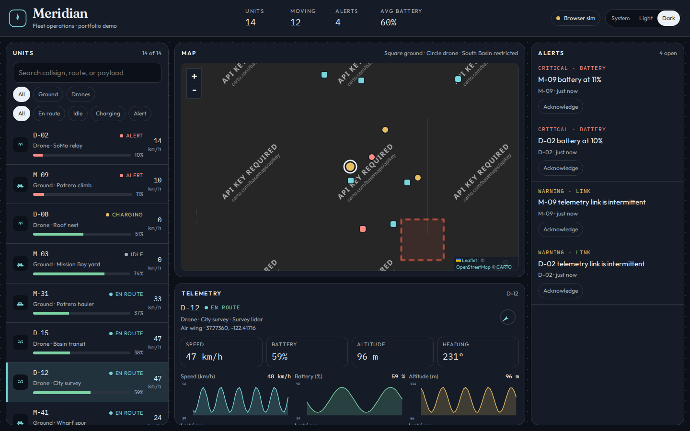
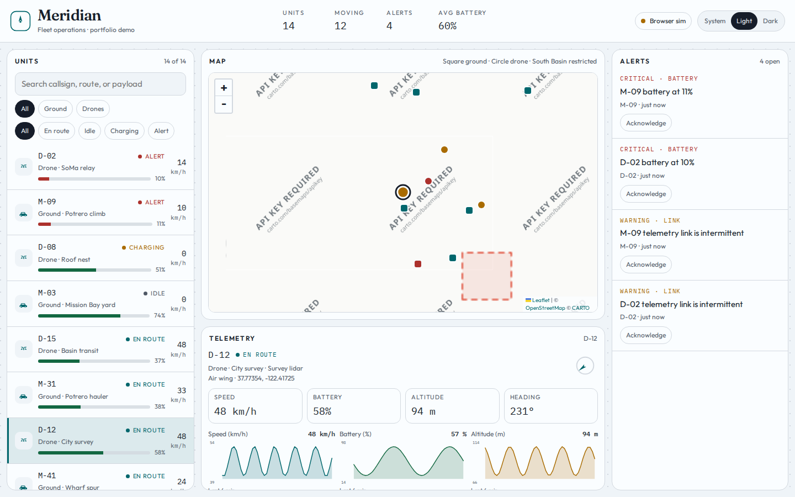
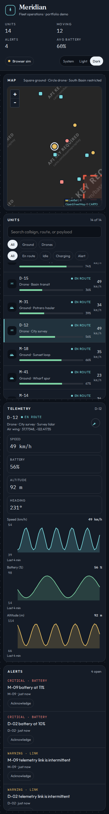
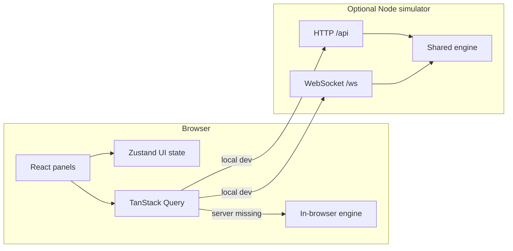

# Meridian

Real-time fleet operations console for ground vehicles and drones. This is a **portfolio demo** by [Arpan Bom](https://github.com/applycoding). The tracks, batteries, and alerts are simulated. Nothing here is connected to a live vehicle, a drone remote ID feed, or an operations center.

[](https://github.com/applycoding/react-ts-fleet-dashboard/actions/workflows/ci.yml)

The same deterministic simulator runs in two places:

- a small Node server with HTTP snapshots and a WebSocket tick, for local development
- the browser itself, when that server is not there (including the GitHub Pages build)

## Screenshots







## Features

- Live map (Leaflet, CARTO basemaps from OpenStreetMap data) with moving ground and drone markers and a restricted-airspace box
- Unit list with search, kind, and status filters
- Telemetry for the selected unit: speed, battery, altitude, and heading over the last few minutes
- Alerts for low battery, intermittent links, and drones inside the restricted box, with acknowledge
- Light, dark, and system color schemes, without a flash of the wrong scheme
- Layout that stacks on narrow viewports
- Vitest and Testing Library coverage, plus a Playwright smoke test
- GitHub Actions CI and a GitHub Pages workflow that ships the in-browser simulator

## Architecture



`src/sim` is the shared engine. Position is a function of time along a fixed route, so the server and the browser draw the same tracks. The React app keeps fleet snapshots and history in TanStack Query. Filters, the selected unit, acknowledgements, and the data-source mode live in Zustand.

On startup the page asks `/api/health`. A response means “live socket”. A miss, or `VITE_FORCE_BROWSER=true` in the Pages build, means the tab runs the engine itself.

## Stack

React 18, TypeScript, Vite, TanStack Query, Zustand, Leaflet, Vitest, Testing Library, Playwright, ESLint, Prettier.

## Run it

```bash
npm install
npm run dev
```

- App: http://localhost:5173
- Simulator: http://127.0.0.1:8787 (`/api/health`, `/api/snapshot`, `/api/units/:id/history`, `POST /api/alerts/:id/ack`, WebSocket `/ws`)

The Vite dev server proxies `/api` and `/ws` to the simulator. Stop the simulator and reload: the badge switches to **Browser sim** and the map keeps moving.

```bash
npm run dev:server   # simulator only
npm run dev:client   # Vite only
npm run build
npm run preview
```

`npm run build` writes a static `dist/` that does not need the Node process.

## Tests

```bash
npm run lint
npm test
npm run test:e2e
```

`test:e2e` builds the static app, serves it, and checks that the in-browser fleet renders and the drone filter works. CI runs lint, the typecheck, unit tests, and that smoke test.

## GitHub Pages

`.github/workflows/pages.yml` builds with `VITE_FORCE_BROWSER=true` and deploys `dist/` with GitHub Pages actions. In the repository settings, set **Pages → Build and deployment → Source** to **GitHub Actions**. After the first deploy on `main` the site is at:

https://applycoding.github.io/react-ts-fleet-dashboard/

Map tiles are loaded from CARTO’s public basemap host. That is fine for a demo; it is not a tile service you should put in front of real traffic.

## License

[MIT](LICENSE) © 2026 Arpan Bom
